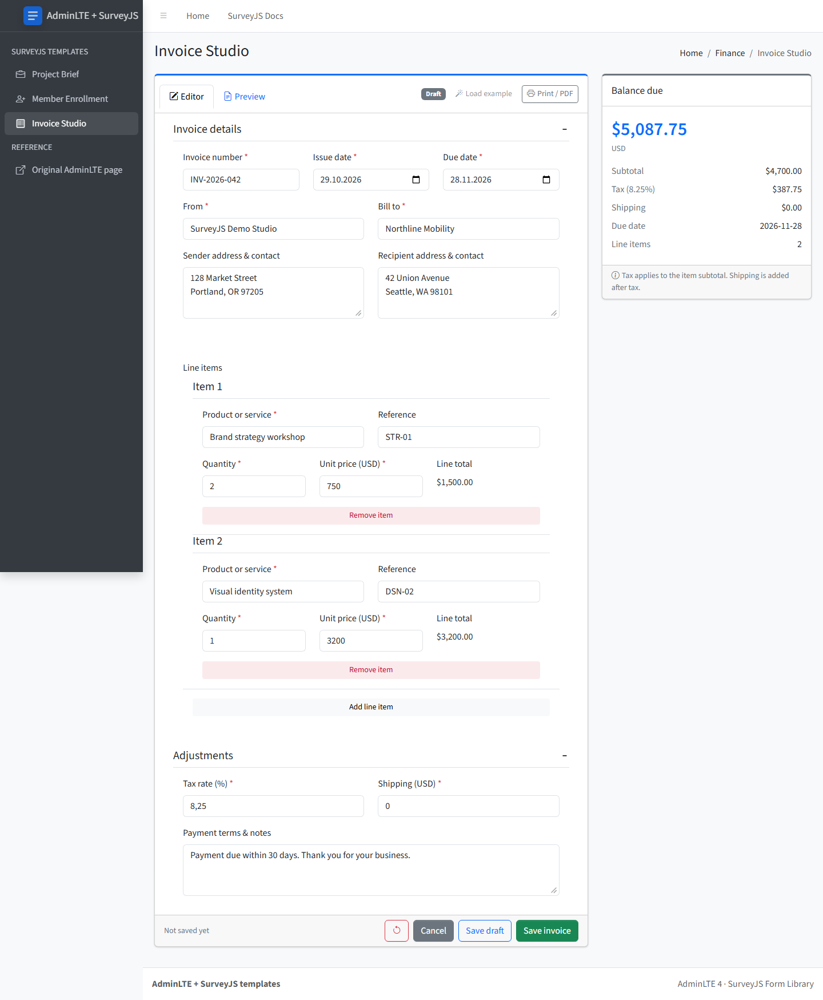
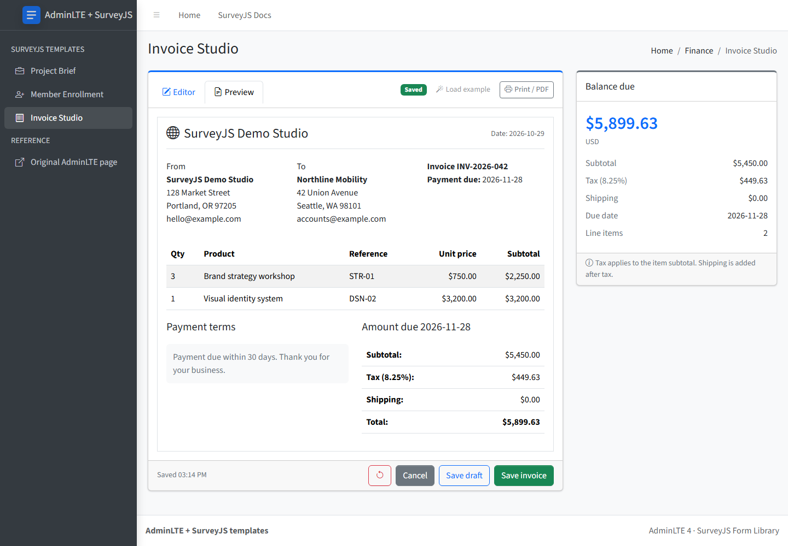

# Invoice Studio — AdminLTE 4 + SurveyJS template

An invoice editor for [AdminLTE 4](https://adminlte.io) built with the free, MIT-licensed [SurveyJS Form Library](https://surveyjs.io/form-library). It turns the read-only AdminLTE [Invoice](https://adminlte.io/themes/v3/pages/examples/invoice.html) example into a working editor: parties and dates, repeatable line items, tax and shipping, live totals, a preview in the AdminLTE invoice layout, and a print view.





## Quick start

Requires Node.js 22.12+.

```bash
npm install
npm run dev
```

Open the URL Vite prints (usually http://localhost:5173/).

| Command | What it does |
| --- | --- |
| `npm run dev` | Development server |
| `npm run build` | Type-check and build static files into `dist/` (relative paths, deployable to any folder) |
| `npm run preview` | Serve the production build |
| `npm test` | Unit tests for calculations, validation and storage (Vitest) |
| `npm run test:e2e` | Browser tests at desktop and mobile widths (Playwright; run `npx playwright install chromium` once) |
| `npm run lint` | Lint with oxlint |

The build prints a chunk-size advisory: the full SurveyJS renderer is bundled into one script (about 520 kB gzipped). It is not an error; split or lazy-load it if that matters for your app.

## What's inside

```
src/
  main.tsx                  CSS imports and the SurveyJS Bootstrap theme adapter
  App.tsx                   page inside the AdminLTE layout
  layout/                   AdminLTE header, sidebar, content header, footer
  pages/InvoiceStudio.tsx   page logic: editor/preview tabs, save, cancel, reset, print
  components/               invoice document, summary card, dialog
  surveys/form.ts           SurveyJS form JSON with calculation expressions, example invoice
  lib/                      browser draft storage, money formatting
  styles/template.css       small adjustments for SurveyJS inside AdminLTE cards
  styles/invoice.css        invoice layout and print rules
```

- **Form and calculations:** edit `src/surveys/form.ts`. Line items are a SurveyJS dynamic panel (readable on phones); totals are SurveyJS expressions.
- **Styling:** SurveyJS renders with Bootstrap classes through the official theme adapter (`survey-core/themes/adapters/bootstrap-default.css` + `setupThemeAdapter('bootstrap')`).
- **Layout:** stock AdminLTE 4 markup and CSS. The sidebar toggle is handled by React; AdminLTE's and Bootstrap's JavaScript are not loaded. AdminLTE 4 has no invoice styles, so `styles/invoice.css` recreates the AdminLTE 3 invoice layout.
- **Sidebar links** to the other templates are in `src/layout/links.ts`.

## Calculation rules

Currency is USD. Each line amount is `round(quantity * unitPrice, 2)`. Subtotal is the sum of rounded line amounts; tax is `round(subtotal * taxRate / 100, 2)`. Shipping is added after tax; the total is rounded to two decimal places. Quantity must be at least 1; prices and shipping must be non-negative; tax must be between 0 and 100; the due date cannot be before the issue date. Up to 30 line items. This is a demonstration, not an accounting or tax engine.

## Behavior

- Starts with a fictional, arithmetically consistent invoice.
- **Save draft** stores incomplete input; **Save invoice** validates first. Reload restores the saved invoice.
- **Preview** shows the invoice document; **Print / PDF** validates and opens the browser print dialog with only the invoice on the page. Choose "Save as PDF" in the dialog for a PDF. There is no payment processing.
- One draft is kept per browser origin in `localStorage` (not encrypted — use non-sensitive data). Storage failures show an error instead of a false "saved" message.

## Credits

- [AdminLTE](https://github.com/ColorlibHQ/AdminLTE) — MIT
- [Bootstrap](https://getbootstrap.com) and [Bootstrap Icons](https://icons.getbootstrap.com) — MIT
- [SurveyJS Form Library](https://github.com/surveyjs/survey-library) — MIT
- [React](https://react.dev) — MIT
- [Source Sans 3](https://github.com/adobe-fonts/source-sans) — SIL Open Font License 1.1

## License

MIT — see [LICENSE](LICENSE).
