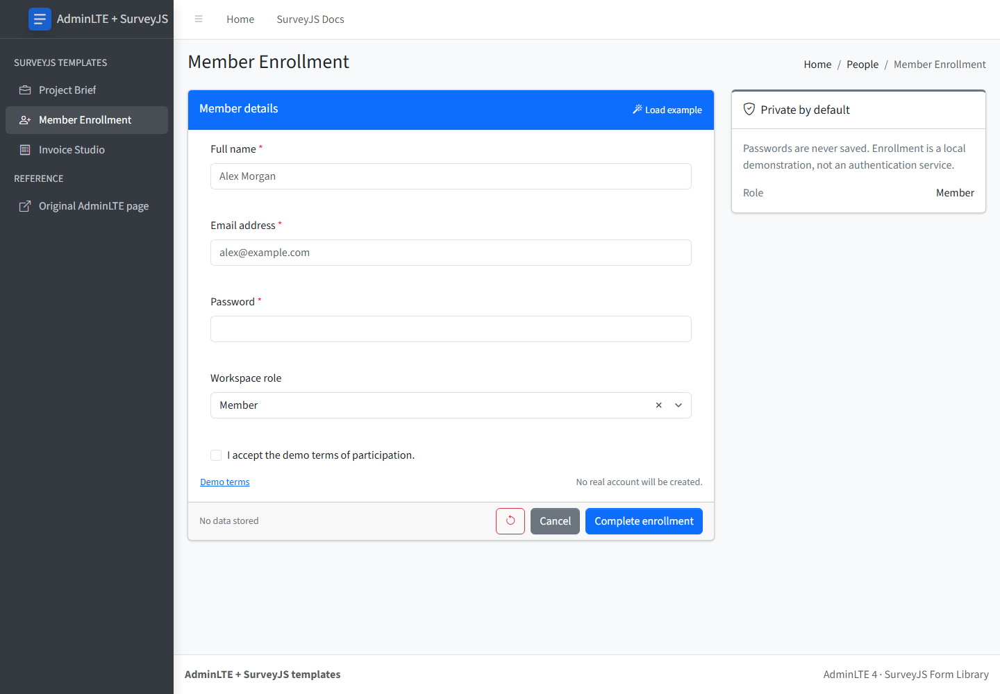

# Member Enrollment — AdminLTE 4 + SurveyJS template

A sign-up form for [AdminLTE 4](https://adminlte.io) built with the free, MIT-licensed [SurveyJS Form Library](https://surveyjs.io/form-library). It reworks the AdminLTE [Validation](https://adminlte.io/themes/v3/pages/forms/validation.html) example: required email with format check, password minimum length, and explicit terms acceptance, all declared in SurveyJS JSON instead of jQuery Validation.



## Quick start

Requires Node.js 22.12+.

```bash
npm install
npm run dev
```

Open the URL Vite prints (usually http://localhost:5173/).

| Command | What it does |
| --- | --- |
| `npm run dev` | Development server |
| `npm run build` | Type-check and build static files into `dist/` (relative paths, deployable to any folder) |
| `npm run preview` | Serve the production build |
| `npm test` | Unit tests for the form rules (Vitest) |
| `npm run test:e2e` | Browser tests at desktop and mobile widths (Playwright; run `npx playwright install chromium` once) |
| `npm run lint` | Lint with oxlint |

The build prints a chunk-size advisory: the full SurveyJS renderer is bundled into one script (about 520 kB gzipped). It is not an error; split or lazy-load it if that matters for your app.

## What's inside

```
src/
  main.tsx                    CSS imports and the SurveyJS Bootstrap theme adapter
  App.tsx                     page inside the AdminLTE layout
  layout/                     AdminLTE header, sidebar, content header, footer
  pages/MemberEnrollment.tsx  page logic: submit, reset, dialogs
  components/                 summary card, success card, dialog
  surveys/form.ts             SurveyJS form JSON, validation rules, example data
  styles/template.css         small adjustments for SurveyJS inside AdminLTE cards
```

- **Form and validation:** edit `src/surveys/form.ts`. Rules are SurveyJS validators (`email`, `text` with `minLength`, `isRequired`).
- **Styling:** SurveyJS renders with Bootstrap classes through the official theme adapter (`survey-core/themes/adapters/bootstrap-default.css` + `setupThemeAdapter('bootstrap')`).
- **Layout:** stock AdminLTE 4 markup and CSS. The sidebar toggle is handled by React; AdminLTE's and Bootstrap's JavaScript are not loaded.
- **Sidebar links** to the other templates are in `src/layout/links.ts`.

## Behavior

- **Complete enrollment** validates and shows a success card. Nothing is created, sent, or stored: this is a simulation.
- The password is never written to browser storage and is cleared after a successful submission.
- **Load example** fills fictional identity details only, never a password or consent.
- **Demo terms** opens a dialog explaining the simulation. The five-character password minimum mirrors the original AdminLTE demo; it is not a recommended production policy.

## Credits

- [AdminLTE](https://github.com/ColorlibHQ/AdminLTE) — MIT
- [Bootstrap](https://getbootstrap.com) and [Bootstrap Icons](https://icons.getbootstrap.com) — MIT
- [SurveyJS Form Library](https://github.com/surveyjs/survey-library) — MIT
- [React](https://react.dev) — MIT
- [Source Sans 3](https://github.com/adobe-fonts/source-sans) — SIL Open Font License 1.1

## License

MIT — see [LICENSE](LICENSE).
