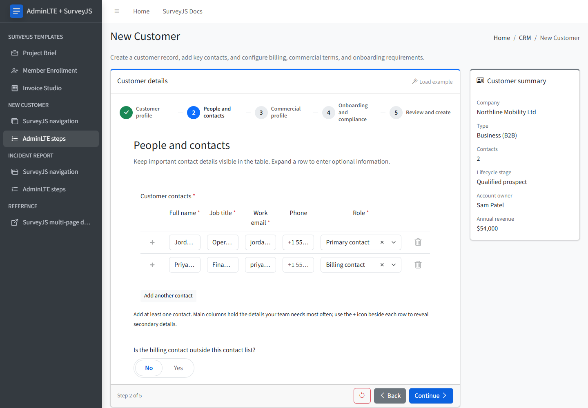

# New Customer (AdminLTE steps) — AdminLTE 4 + SurveyJS template

A five-page CRM onboarding form: company profile, a contacts table whose rows expand to secondary details, revenue estimate and payment terms, onboarding and compliance questions, and a review page. Built for [AdminLTE 4](https://adminlte.io) with the free, MIT-licensed [SurveyJS Form Library](https://surveyjs.io/form-library).

This version replaces SurveyJS navigation with **AdminLTE-styled steps**: a numbered step list above the form and Back / Continue / Submit buttons in the card footer. Its twin, [New Customer (SurveyJS navigation)](../new-customer-surveyjs-nav/), uses the same form JSON with the other navigation style. Everything else is identical, so the two can be compared side by side.



## Quick start

Requires Node.js 22.12+.

```bash
npm install
npm run dev
```

Open the URL Vite prints (usually http://localhost:5173/).

| Command | What it does |
| --- | --- |
| `npm run dev` | Development server |
| `npm run build` | Type-check and build static files into `dist/` (relative paths, deployable to any folder) |
| `npm run preview` | Serve the production build |
| `npm test` | Unit tests for the form definition and file handling (Vitest) |
| `npm run test:e2e` | Browser tests at desktop and mobile widths (Playwright; run `npx playwright install chromium` once) |
| `npm run lint` | Lint with oxlint |

The build prints a chunk-size advisory: the full SurveyJS renderer is bundled into one script. It is not an error; split or lazy-load it if that matters for your app.

## What's inside

```
src/
  main.tsx                   CSS imports and the SurveyJS Bootstrap theme adapter
  App.tsx                    page inside the AdminLTE layout
  layout/                    AdminLTE header, sidebar, content header, footer
  pages/NewCustomer.tsx      page: form card, summary, start over, submitted data
  components/                step list, summary card, submitted-data card, dialog
  lib/useSurveySteps.ts      connects the step list and footer buttons to the SurveyJS page API
  lib/useSurveyForm.ts       live re-render, unsaved-changes guard, result, restart
  surveys/new-customer.json  the form definition (plain JSON; opens in SurveyJS Creator)
  surveys/form.ts            loads the JSON, navigation settings, example data, summary rows
  surveys/files.ts           demo upload handler: files stay in the browser
  styles/template.css        adjustments for SurveyJS inside AdminLTE cards
```

## Navigation

- `surveys/form.ts` turns off SurveyJS's own buttons and progress bar: `const NAVIGATION = { showNavigationButtons: false, showProgressBar: false }`.
- `lib/useSurveySteps.ts` reads `visiblePages` and calls `nextPage()`, `prevPage()` and `completeLastPage()`. Button labels still come from the JSON (`pagePrevText`, `pageNextText`, `completeText`).
- Steps follow the visible pages, so pages hidden by `visibleIf` drop out of the list. Every step is a button: going back never validates; going forward validates each page on the way and stops on the first page with errors.
- After a page change, focus moves to the current step so keyboard and screen reader users start at the top of the new page.
- Below the `xl` breakpoint the steps show numbers only; the page title names the current step.

## Behavior

- **Load example** fills every page with fictional data except the final confirmation.
- The summary card beside the form updates as you answer.
- Submitting shows the completion text from the JSON and the JSON result SurveyJS produced. Nothing is sent or stored.
- **Start over** asks for confirmation, then clears every page. Leaving the page with unsaved answers triggers the browser's warning.
- File uploads stay in the browser as object URLs (`surveys/files.ts`). In production, upload `options.files` to your storage in `onUploadFiles` and pass the stored URLs to `options.callback`.
- The page header shows the form title and description, so the survey's own title is hidden (`showTitle: false`). Page titles render as `<h4>` headings so screen reader users can jump between pages.

## Changes from the source JSON

- Removed `calculatedValues.estimatedAnnualRevenue`: it duplicated the `annualRevenuePreview` expression, so the result carried the same number twice.
- Boolean `defaultValue`s are `false` instead of the string `"false"`.
- `supportingDocuments` uses `storeDataAsText: false` with the upload handler in `surveys/files.ts`, instead of embedding files as base64 in the result.
- Removed `logoPosition` (no logo is set).

## Credits

- [AdminLTE](https://github.com/ColorlibHQ/AdminLTE) — MIT
- [Bootstrap](https://getbootstrap.com) and [Bootstrap Icons](https://icons.getbootstrap.com) — MIT
- [SurveyJS Form Library](https://github.com/surveyjs/survey-library) — MIT
- [React](https://react.dev) — MIT
- [Source Sans 3](https://github.com/adobe-fonts/source-sans) — SIL Open Font License 1.1

## License

MIT — see [LICENSE](LICENSE).
