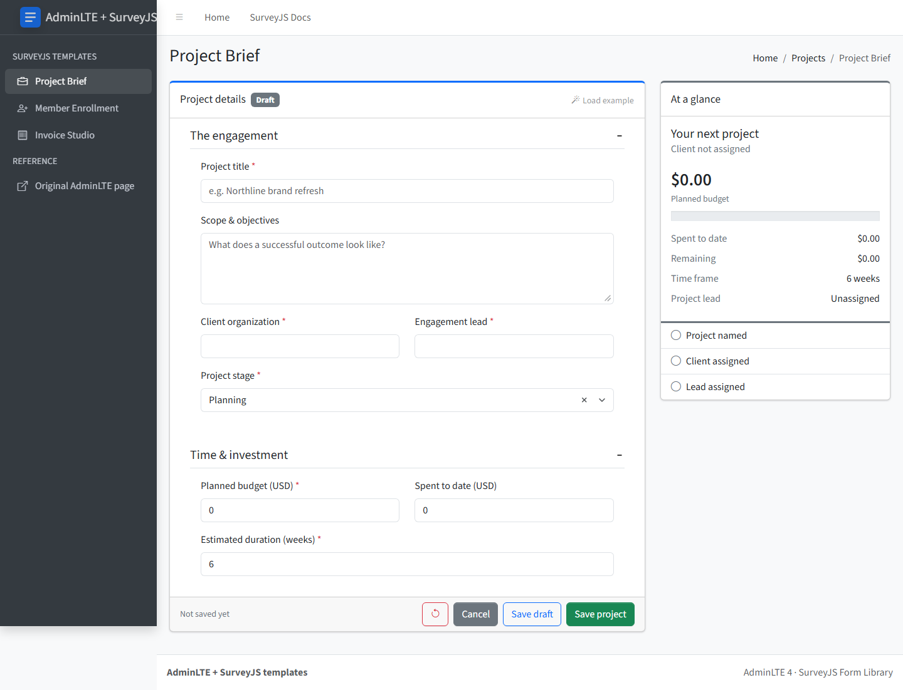

# Project Brief — AdminLTE 4 + SurveyJS template

A project intake page for [AdminLTE 4](https://adminlte.io) where the form is built with the free, MIT-licensed [SurveyJS Form Library](https://surveyjs.io/form-library). It reworks the AdminLTE [Project Add](https://adminlte.io/themes/v3/pages/examples/project-add.html) example: same fields and collapsible groups, plus validation, draft saving, and a live budget summary.



## Quick start

Requires Node.js 22.12+.

```bash
npm install
npm run dev
```

Open the URL Vite prints (usually http://localhost:5173/).

| Command | What it does |
| --- | --- |
| `npm run dev` | Development server |
| `npm run build` | Type-check and build static files into `dist/` (relative paths, deployable to any folder) |
| `npm run preview` | Serve the production build |
| `npm test` | Unit tests for the form definition and storage (Vitest) |
| `npm run test:e2e` | Browser tests at desktop and mobile widths (Playwright; run `npx playwright install chromium` once) |
| `npm run lint` | Lint with oxlint |

The build prints a chunk-size advisory: the full SurveyJS renderer is bundled into one script (about 520 kB gzipped). It is not an error; split or lazy-load it if that matters for your app.

## What's inside

```
src/
  main.tsx              CSS imports and the SurveyJS Bootstrap theme adapter
  App.tsx               page inside the AdminLTE layout
  layout/               AdminLTE header, sidebar, content header, footer
  pages/ProjectBrief.tsx  page logic: save, cancel, reset, messages
  components/           summary card and dialog
  surveys/form.ts       SurveyJS form JSON, example data
  lib/                  browser draft storage, money formatting
  styles/template.css   small adjustments for SurveyJS inside AdminLTE cards
```

- **Form:** edit `src/surveys/form.ts`. It is plain SurveyJS JSON; fields, validation and panels are defined there.
- **Styling:** SurveyJS renders with Bootstrap classes through the official theme adapter (`survey-core/themes/adapters/bootstrap-default.css` + `setupThemeAdapter('bootstrap')`), so it picks up AdminLTE's Bootstrap styles.
- **Layout:** stock AdminLTE 4 markup and CSS. The sidebar toggle is handled by React; AdminLTE's and Bootstrap's JavaScript are not loaded.
- **Sidebar links** to the other templates are in `src/layout/links.ts`.

## Behavior

- **Save draft** stores incomplete input; **Save project** validates first. Reload restores the saved record.
- **Cancel** returns to the last saved version; the reset button clears the form and removes the draft after confirmation.
- Overspend is allowed and shown in red in the summary.
- One draft is kept per browser origin in `localStorage` (not encrypted — use non-sensitive data). Storage failures show an error instead of a false "saved" message.
- Leaving the page with unsaved changes asks for confirmation.

## Credits

- [AdminLTE](https://github.com/ColorlibHQ/AdminLTE) — MIT
- [Bootstrap](https://getbootstrap.com) and [Bootstrap Icons](https://icons.getbootstrap.com) — MIT
- [SurveyJS Form Library](https://github.com/surveyjs/survey-library) — MIT
- [React](https://react.dev) — MIT
- [Source Sans 3](https://github.com/adobe-fonts/source-sans) — SIL Open Font License 1.1

## License

MIT — see [LICENSE](LICENSE).
